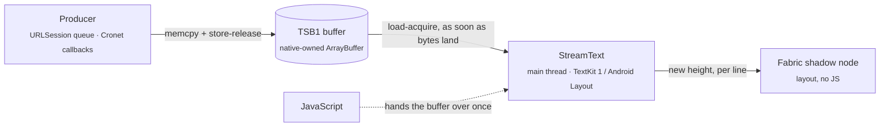

<p align="center">
  
</p>

<h1 align="center">react-native-text-stream</h1>

<p align="center">
  <b>Stream text from native code straight into a native view. No JS per chunk.</b><br />
  A native streaming text component for React Native: render LLM / AI chat answers, logs and transcripts<br />
  token by token, with no <code>setState</code>, no re-renders and no bridge traffic.
</p>

<p align="center">
  
  
  
</p>

<p align="center">
  <a href="#quick-start"><b>Quick start</b></a> ·
  <a href="#usage">Usage</a> ·
  <a href="#api">API</a> ·
  <a href="#how-it-works">How it works</a> ·
  <a href="#benchmarks">Benchmarks</a> ·
  <a href="#run-the-example">Example</a> ·
  <a href="#faq">FAQ</a> ·
  <a href="#roadmap">Roadmap</a>
</p>

---

## Why

LLM answers, logs, and transcripts arrive as a stream of bytes. In a typical React Native app each chunk
travels through JavaScript: a callback, a UTF-8 decode, a `setState`, a re-render of an ever-growing
`<Text>`. That is fine at a few tokens per second. It falls apart for long answers, fast streams, or a
busy JS thread.

**react-native-text-stream** takes JavaScript off that path. The network layer writes the response body
into a shared native buffer, and the `StreamText` view picks up new bytes as soon as they land, on the UI
thread. JavaScript hands the buffer over **once** and steps aside.

```tsx
const res = await fetch(url, { stream: true, nativeBuffer: true });

<StreamText source={res.nativeBuffer} />
```

> [!TIP]
> 🎬 **See it in action:** [`media/native-text-streaming-demo.mp4`](media/native-text-streaming-demo.mp4).
> The JS thread is frozen for 5 s, and the native card keeps streaming while the JS card stops dead.

### At a glance

A 100 KB answer streaming into a chat bubble ([full benchmarks](#benchmarks)):

| | `setState` per chunk | **StreamText** |
|---|---|---|
| Delay, network → screen (typical / worst 5%) | 205 / 708 ms | **11 / 18 ms** |
| …the same while the JS thread is busy | 168 / 697 ms | **11 / 17 ms** |
| Stutters (late frames) | 22 | **0** |
| Longest frame | 875 ms | **17 ms** (no late frame) |

## Highlights

- 💬 **Sizes itself to its text, like `<Text>`.** Drop it into a chat bubble, a list cell or a
  `ScrollView`; it grows natively as the text arrives.
- ⚡️ **Zero JS per chunk.** No bridge traffic, no `setState`, no re-renders while text streams in.
- 🧊 **Unaffected by a busy JS thread.** Text keeps flowing, and the bubble keeps growing, during heavy
  renders, navigation or a frozen JS thread.
- 🚀 **Fastest in a chat bubble.** 11–23 ms from the network to the screen and 0 stutters, for a 5 KB or a
  100 KB answer, with the JS thread idle or busy.
- 📈 **O(new bytes) per update.** Each update decodes only the new UTF-8 slice. A 100 KB answer streams as
  smoothly as a 1 KB one.
- 🎯 **Smooth under bursts.** An adaptive per-frame budget spreads a burst over frames instead of dropping
  them.
- 🔋 **Idle-aware.** Without new bytes the main thread sleeps; a background watcher wakes it the moment text
  lands, and backs off while the model is thinking.
- 🧩 **Producer-agnostic.** Any native module that writes the small [TSB1](#the-tsb1-buffer) layout can
  feed the view. A patched [nitro-fetch](https://github.com/margelo/react-native-nitro-fetch) is the first
  producer.
- ♿️ **Accessible.** VoiceOver and TalkBack read the text on screen line by line, without snapshotting
  megabytes of it.
- 🤖 **iOS and Android.** The same component, props and buffer on both, with the same frame loop and the
  same O(new bytes) streaming.

### Is it a good fit?

| ✅ Great for | ⚠️ Limitations today |
|---|---|
| Streaming LLM / AI chat answers into chat bubbles | Plain text only: no Markdown or rich text yet |
| Long or fast plain-text streams: logs, transcripts, "thinking" panels | SSE / NDJSON bodies show up raw: the view renders the response body as-is ([FAQ](#faq)) |
| Apps whose JS thread is busy while text streams in | Mounting a large *finished* message lays it out in the React commit: ~20–50 ms of JS ([details](#tldr)) |
| Empty "waiting" bubbles: 20 of them mount in one frame | |

## Quick start

> [!NOTE]
> This is an **experimental prototype**, not yet published to npm. The `nativeBuffer` option
> comes from a patched `react-native-nitro-fetch` vendored in this repo. See the [roadmap](#roadmap).

### Requirements

| | Version |
|---|---|
| React Native | **0.86+** with the New Architecture |
| iOS | 15.1+ |
| Android | 7.0+ (API 24); drawing only the lines near the screen needs 10+ (API 29) |
| [`react-native-nitro-modules`](https://nitro.margelo.com) | used by the patched nitro-fetch (and the example app's benchmark helpers), not by the package |

`StreamText` itself is a plain Fabric component and doesn't go through Nitro.

### Install

Clone the repo and use the workspace packages:

```sh
git clone https://github.com/alexshumihin/react-native-text-stream.git
cd react-native-text-stream
bun install                  # also applies the patches in patches/
```

## Usage

There are two ways to hand a stream to the view. Both work together: whichever was set last, the `source`
prop or `attach()`, wins.

### Option 1: the `source` prop

```tsx
import { useState } from 'react';
import { Button, ScrollView } from 'react-native';
import { fetch } from 'react-native-nitro-fetch';
import { StreamText } from 'react-native-text-stream';

export function Chat() {
  const [buffer, setBuffer] = useState<ArrayBuffer>();

  const ask = async () => {
    // The body is written natively into `nativeBuffer` as it arrives.
    const res = await fetch('https://example.com/stream', { stream: true, nativeBuffer: true });
    setBuffer(res.nativeBuffer); // the only time JS touches the stream
  };

  return (
    <ScrollView>
      <Button title="Ask" onPress={ask} />
      <StreamText
        source={buffer}
        fontSize={16}
        lineHeight={22}
        style={{ padding: 12, borderRadius: 16, backgroundColor: '#eee' }}
      />
    </ScrollView>
  );
}
```

### Option 2: a ref, with no re-render at all

```tsx
import { fetch } from 'react-native-nitro-fetch';
import { StreamText, useStreamTextRef } from 'react-native-text-stream';

export function Chat() {
  const streamRef = useStreamTextRef();

  const ask = async () => {
    const res = await fetch('https://example.com/stream', { stream: true, nativeBuffer: true });
    streamRef.attach(res.nativeBuffer); // no setState, no re-render
  };

  return <StreamText ref={streamRef} fontSize={16} style={{ padding: 12 }} />;
}
```

### Recipes

<details>
<summary><b>React when the stream finishes</b></summary>

`onStatusChange` fires with `'streaming'` when a stream starts and with a final status once all of its
text is on screen:

```tsx
const FINAL = ['done', 'error', 'cancelled', 'truncated'];

<StreamText
  source={buffer}
  onStatusChange={(status, bytes) => {
    if (FINAL.includes(status)) console.log(`${status} after ${bytes} bytes`);
  }}
/>
```

</details>

<details>
<summary><b>A fixed-height panel that follows the newest text (a log, a "thinking" box)</b></summary>

Wrap `StreamText` in an inverted `ScrollView` (`transform: [{ scaleY: -1 }]` on the scroll view and on its
child): offset 0 is then the bottom, so the panel stays pinned to the tail without JS. The demo's native
card does this:

```tsx
<ScrollView
  style={{ height: 200, transform: [{ scaleY: -1 }] }}
  // Keeps short text at the visual top while it is shorter than the panel.
  contentContainerStyle={{ flexGrow: 1, justifyContent: 'flex-end' }}
>
  <View style={{ transform: [{ scaleY: -1 }] }}>
    <StreamText ref={streamRef} fontSize={14} lineHeight={21} />
  </View>
</ScrollView>
```

</details>

## API

### `<StreamText />`

`StreamText` lays out like `<Text>`: it takes the width it is given and grows to the height of its text.
`padding`, `margin`, `backgroundColor`, `borderRadius` and the rest of the view style work as usual.

| Prop | Type | Default | Description |
|---|---|---|---|
| `source` | `ArrayBuffer \| null` | — | A TSB1 buffer, e.g. `res.nativeBuffer`. `null`/`undefined` detaches and clears the view. |
| `fontSize` | `number` | `15` | Font size in points. |
| `fontFamily` | `string` | system font | A family or PostScript name, e.g. `"Menlo"`. |
| `fontWeight` | `'normal' \| 'bold' \| '100'…'900'` | `'normal'` | |
| `color` | `ColorValue` | system label color | Any React Native color. |
| `lineHeight` | `number` | the font's own | Line height in points. |
| `letterSpacing` | `number` | `0` | |
| `textAlign` | `'auto' \| 'left' \| 'right' \| 'center' \| 'justify'` | `'auto'` | |
| `selectable` | `boolean` | `true` | |
| `selectionColor` | `ColorValue` | tint color | |
| `onStatusChange` | `(status, bytes) => void` | — | See [stream statuses](#stream-statuses). |
| `ref` | `StreamTextRef` | — | From [`useStreamTextRef()`](#usestreamtextref), or any `useRef<StreamTextHandle>(null)`. |

### `useStreamTextRef()`

Returns a ref for `<StreamText ref={streamRef} />` that you can call directly. It is stable across renders.

| Method | Description |
|---|---|
| `attach(buffer)` | Starts rendering `buffer` without a React render. Called before the view mounts, it applies on mount. |
| `clear()` | Detaches and clears the view. |
| `getStatus()` | `{ status, bytes }`, read synchronously from the buffer's header and the last status event. |
| `getText()` | The text received so far, decoded from the buffer. |

A plain `useRef<StreamTextHandle>(null)` works too; call `ref.current?.attach(buffer)`.

### Stream statuses

`onStatusChange` reports `'streaming'` when a stream starts, then one final status once all of its text is
on screen. A buffer that is already finished when attached (e.g. a message remounted by a list) reports
only its final status.

| Status | Meaning |
|---|---|
| `'idle'` | No buffer attached: the view was cleared, or the source isn't a valid TSB1 buffer. |
| `'streaming'` | The stream has started. |
| `'done'` | The stream finished and all of its text is on screen. |
| `'error'` | The request failed. |
| `'cancelled'` | The request was cancelled. |
| `'truncated'` | The buffer filled up; the rest of the response was dropped. |

### `fetch(url, { stream: true, nativeBuffer })`

From the patched nitro-fetch:

| Option | Type | Description |
|---|---|---|
| `nativeBuffer` | `true \| { capacity?: number }` | Writes the body into a TSB1 buffer exposed as `res.nativeBuffer` instead of `res.body`. `true` reserves 16 MB of address space; pages are committed only as they're written. |

The body never crosses into JS. When the stream ends, fails or is cancelled, the buffer's status changes and
the view shows the final state.

### Exported types

`StreamTextProps`, `StreamTextHandle`, `StreamTextRef`, `StreamTextStatus`, `StreamTextState`,
`StreamTextAlign`, `StreamTextFontWeight`.

## How it works



1. **Producer.** nitro-fetch appends every received chunk to the buffer, on URLSession's queue on iOS and in
   Cronet's read callbacks on Android, and publishes it with a release store of `committed`. When the
   request finishes it sets `status`.
2. **Handoff.** JavaScript passes `res.nativeBuffer` to the view once: as the `source` prop, read straight
   from the JS value by the component's props parser, or through `ref.attach()`. Fabric view commands
   can't carry an `ArrayBuffer`, so `attach()` first puts it in a small C++ TurboModule
   (`StreamTextBuffers`) and sends the view the buffer's id.
3. **Renderer.** A background watcher reads `status`, then `committed`, with acquire loads every few
   milliseconds, and wakes the main thread as soon as new bytes land. The renderer decodes only the new
   slice (a UTF-8 sequence split across chunks is carried over) and appends it to a TextKit 1 text view, so
   the text is on screen in the next frame.
4. **Layout.** When the text gains a line, the view reports its new height through the Fabric shadow node's
   state. The update is applied on the main thread, so the bubble grows and the list re-lays out while the
   JS thread is busy.

<details>
<summary><b>Frame loop details</b></summary>

- **Adaptive budget.** At most `bytesPerTick` per wake, re-estimated from the measured append and layout
  cost so the work stays around 6 ms per frame. A larger backlog continues on the display link, which runs
  only while there is one.
- **Incremental layout.** Contiguous TextKit 1 layout: appending lays out only the new tail, and the height
  comes from the used rect. The text view keeps a fixed, very tall frame and is clipped to the component,
  because a text view whose frame grows re-lays out all of its text.
- **Idle.** Without new bytes the main thread sleeps. The watcher checks the header every 8 ms while data
  flows, every 16 ms after a second of quiet, and every 50 ms after 5 s (a model "thinking"); it stops at the
  final status.
- **Cheap to mount.** The text view is created on the first text, so an empty bubble is a plain view, and
  text views are reused from a small pool.
- **Accessibility.** Only the last 2000 characters are exposed, in the component's visible frame, so an
  accessibility snapshot of a long stream stays cheap.

</details>

<details>
<summary><b>On Android</b></summary>

The C++ shadow node, the props and the buffer are shared; the view is Kotlin.

- **Handoff.** Android props reach Kotlin as `folly::dynamic` and lose the `ArrayBuffer`, so the `source`
  travels through the shadow node's state and JNI.
- **Text.** A `DynamicLayout` over the streamed text, appended in O(new bytes): line height spans in
  segments of 1 KB (one span over the whole text made every append re-wrap all of it), and past 96 lines
  of one paragraph the lines above the last two are frozen as they stand, since greedy wrapping never
  moves them again. Lines match `<Text>` to the pixel: the same line height rounding, font padding and
  fallback line spacing.
- **Finished messages.** As on iOS, the shadow node lays a finished `source` out in measure (a
  `StaticLayout` built through JNI, on two background threads when React renders the message), and the
  view draws it as is.
- **Drawing.** The text is drawn in blocks of 32 lines, each its own `RenderNode`, recorded only within
  512 dp of the screen; an append re-records only the blocks it touched.
- **Selection.** A long press lays a selectable `TextView` with the same lines over the view, which brings
  the system's handles, magnifier and toolbar.
- **TalkBack** moves through the lines on screen by character, word, line or paragraph.

</details>

### The TSB1 buffer

A single-writer, multi-reader, append-only byte log in one block of memory. Any native producer can write it.
The full contract is in [`TextStreamBuffer.h`](packages/react-native-text-stream/ios/TextStreamBuffer.h).

| Offset | Field | Type | Notes |
|---|---|---|---|
| 0 | `magic` | `u32` | `0x31425354` (`"TSB1"`) |
| 4 | `version` | `u16` | `1` |
| 6 | `headerSize` | `u16` | `64` |
| 8 | `committed` | `u64` | bytes published; written with release, read with acquire |
| 16 | `capacity` | `u64` | size of the data region |
| 24 | `status` | `u32` | `OPEN 0` · `DONE 1` · `ERROR 2` · `CANCELLED 3` · `OVERFLOW 4`; the first terminal status wins |
| 64 | data | `u8[capacity]` | `[0, committed)` is immutable once published |

<details>
<summary><b>Writing your own producer (Swift)</b></summary>

```swift
// Allocate: anonymous mmap pages are only committed once written.
let size = Int(TSB_HEADER_SIZE) + capacity
let base = mmap(nil, size, PROT_READ | PROT_WRITE, MAP_PRIVATE | MAP_ANON, -1, 0)!
tsb_init(base, UInt64(capacity))
let buffer = ArrayBuffer.wrap(dataWithoutCopy: base, size: size, onDelete: { munmap(base, size) })
// Return `buffer` to JS and pass it to <StreamText source={…} />.

// From one writer thread, as data arrives:
bytes.withUnsafeBytes { _ = tsb_append(base, $0.baseAddress!, UInt64($0.count)) }

// When finished:
tsb_set_status(base, UInt32(TSB_STATUS_DONE))
```

The buffer must be **native-owned**. The view ignores `ArrayBuffer`s created in JavaScript, because those
may only be touched on the JS thread.

</details>

## Benchmarks

The same answer, streamed five ways. Release build on an iPhone 17 Pro Max **simulator**; each streaming
number is the median of 2 runs, each mounting number the median of 3 cold runs. Mounting on a real
**iPhone 16 Pro** (120 Hz): [device results](bench-results/iphone16pro-2026-10-11.md). Android, streaming
and mounting on a **Pixel 8a**: [device results](bench-results/pixel8a-2026-10-12.md).

### TL;DR

- **Streaming:** StreamText is the fastest and the smoothest in every chat-bubble scenario: about 11–23 ms
  of delay, **0 stutters**, whether the answer is 5 KB or 100 KB, and whether the JS thread is idle or busy.
  The `setState` versions reach 0.5–1 s of delay and ~1 s frames on a long answer.
- **On its own**, with a short answer and an idle JS thread, `setState` per chunk is 2–3 ms faster; on
  everything longer, StreamText wins by 2–10×.
- **Mounting finished messages:** StreamText is on screen first and never drops a frame: 34 ms for a 50 KB
  message against 51 ms for `<Text>`, and 50 ms for 20 × 5 KB, where `<Text>` takes 134 ms and stalls for
  475 ms. On an iPhone 16 Pro its longest frame stays at 8 ms, one 120 Hz frame
  ([device results](bench-results/iphone16pro-2026-10-11.md)).
- **Where StreamText costs more:**
  - Mounting lays the text out in the React commit, on the JS thread: 22 ms of JS for 50 KB and 38 ms for
    20 × 5 KB (`<Text>` takes 43 and 118 ms there).
  - A 1 MB burst: StreamText spreads it over frames on purpose (no long frame, but all of it is on screen
    after ~1.7 s).

### Contenders

| | Contender | How the text gets on screen |
|---|---|---|
| **A1** | `setState` per chunk | JS reads the stream, `setState` on every chunk, `<Text>` re-renders |
| **A2** | `setState` per frame | the same, batched to one `setState` per frame |
| **B1** | Reanimated | JS writes a shared value, a `TextInput` shows it from the UI thread |
| **B2** | react-native-streamdown | `setState` per frame, Markdown parsed on a worklet |
| **C** | **StreamText** | the native buffer goes straight to the view; no JS per chunk |

**How to read the tables**

- **Delay** is the time from the server sending the text until it is on screen. Two numbers: typical /
  worst 5% (p50 / p95). Lower is better.
- **Stutters** is how many frames were late (a frame over 1.5× its budget). **0 means perfectly smooth.**
- **Longest frame**: one 60 Hz frame is 17 ms, so **17 ms means no frame was late at all**.
- The best result in each row is in **bold**.

### 1. In a chat bubble (the main use case)

The answer streams into the last bubble of a chat list. The bubble grows with the text.

**Delay, ms (typical / worst 5%)**

| Scenario | A1 | A2 | B1 | B2 | **StreamText** |
|---|---|---|---|---|---|
| Short answer at LLM pace (5 KB) | 15 / 49 | 29 / 65 | 36 / 78 | 42 / 50 | **13 / 23** |
| Long answer (100 KB) | 205 / 708 | 186 / 741 | 566 / 1119 | 131 / 300 | **11 / 18** |
| Long answer while the JS thread is busy | 168 / 697 | 209 / 737 | 573 / 1115 | 162 / 367 | **11 / 17** |
| Long answer, 2 KB paragraphs | 169 / 568 | 148 / 550 | 396 / 783 | 190 / 503 | **11 / 17** |
| Long answer, one 100 KB paragraph | 151 / 617 | 159 / 760 | 382 / 766 | 201 / 471 | **11 / 17** |
| A few bytes every 400 ms | **14** / 36 | 27 / 52 | 35 / 48 | 44 / 51 | 16 / **21** |

**Stutters, and the longest frame**

| Scenario | A1 | A2 | B1 | B2 | **StreamText** |
|---|---|---|---|---|---|
| Short answer at LLM pace (5 KB) | 75 · 67 ms | 71 · 70 ms | 70 · 50 ms | **0 · 17 ms** | **0 · 17 ms** |
| Long answer (100 KB) | 22 · 875 ms | 23 · 996 ms | 30 · 612 ms | 66 · 161 ms | **0 · 17 ms** |
| Long answer while the JS thread is busy | 25 · 952 ms | 21 · 970 ms | 26 · 612 ms | 67 · 199 ms | **0 · 17 ms** |
| Long answer, 2 KB paragraphs | 27 · 701 ms | 29 · 681 ms | 35 · 432 ms | 52 · 344 ms | **0 · 17 ms** |
| Long answer, one 100 KB paragraph | 28 · 737 ms | 28 · 734 ms | 36 · 426 ms | 56 · 318 ms | **0 · 17 ms** |
| A few bytes every 400 ms | 14 · 38 ms | 16 · 38 ms | 17 · 99 ms | **0 · 17 ms** | **0 · 17 ms** |
| 1 MB all at once | 2 · 277 ms | **0 · 17 ms** | 4 · 5452 ms | 1 · 1949 ms | 2 · 51 ms |

<details>
<summary><b>2. On its own, outside any list</b></summary>

The text in a plain `View`, nothing scrolls: the component alone.

| Scenario | A1 | A2 | B1 | B2 | **StreamText** |
|---|---|---|---|---|---|
| Short answer at LLM pace (5 KB) | **11 / 19 ms** · 0 | 26 / 34 ms · 0 | 28 / 36 ms · 1 | 43 / 50 ms · 0 | 14 / 23 ms · **0** |
| Long answer (100 KB) | 26 / 50 ms · 0 | 31 / 77 ms · 0 | 59 / 132 ms · 66 | 115 / 244 ms · 75 | **12 / 18 ms · 0** |
| Long answer while the JS thread is busy | 13 / 46 ms · 0 | 31 / 62 ms · 0 | 54 / 119 ms · 36 | 121 / 245 ms · 59 | **11 / 18 ms · 0** |
| Long answer, one 100 KB paragraph | 65 / 188 ms · 53 | 68 / 208 ms · 53 | 100 / 187 ms · 69 | 149 / 301 ms · 69 | **12 / 18 ms · 0** |
| A few bytes every 400 ms | **12 / 19 ms** · 0 | 24 / 33 ms · 0 | 27 / 35 ms · 0 | 42 / 51 ms · 0 | 17 / 23 ms · **0** |

Cells: delay (typical / worst 5%) · stutters.

</details>

<details>
<summary><b>3. Showing a finished answer</b></summary>

How long it takes to mount text that is already complete (for example an earlier message). Each run
mounts texts nothing has laid out before. Cells: on screen / longest frame, in ms; 17 ms is one 60 Hz
frame, so **/ 17** means no frame was late.

| What is mounted | `<Text>` | `TextInput` | streamdown | **StreamText** |
|---|---|---|---|---|
| 1 message, 5 KB | **17 / 17** | **17 / 17** | 25 / 17 | **17 / 17** |
| 1 message, 50 KB | 51 / 17 | 51 / 17 | 17 / 105 | **34 / 17** |
| 20 messages, 600 B each | 34 / 104 | 90 / 130 | 31 / 47 | **33 / 17** |
| 20 messages, 5 KB each | 134 / 475 | 229 / 520 | 18 / 205 | **50 / 17** |
| JS time in the commit: 50 KB · 20 × 5 KB | 43 · 118 ms | 34 · 117 ms | **2 · 8 ms** | 22 · 38 ms |
| 20 empty bubbles, waiting for the first token | — | — | — | **17 / 17** |
| Memory for 20 messages of 5 KB¹ | 747 MB | — | 261 MB | **≈ 5 MB** |

streamdown is on screen early, but its long frames come after that. On an iPhone 16 Pro (120 Hz)
StreamText's longest frame is 8 ms in every row but 20 × 600 B (22 ms):
[device results](bench-results/iphone16pro-2026-10-11.md).

¹ From [an earlier run](bench-results/mount-watcher-2026-10-11T13-20-11-895Z.json); `TextInput` read as
negative (the memory reading is noisy), so it is left out.

</details>

<details>
<summary><b>4. A long chat</b></summary>

StreamText in a list of 120 finished messages (870 KB of text):

| | StreamText |
|---|---|
| Mount all 120 messages at once | 566 ms |
| Mount 120 empty bubbles | 17 ms (one frame) |
| Add one more message | shown in the same frame |
| Scroll a FlatList of them (40 000 pt) | longest frame 33 ms |
| Stream an answer below the 120 messages | **0 stutters** |

</details>

<details>
<summary><b>Methodology and raw results</b></summary>

- **Delay** of a byte: the time the stream server wrote it (its log is the clock; the simulator and the
  host share `Date.now()`) to the first frame after the main thread drew it. For JS variants that is the
  first frame after the React commit; for StreamText, the frame after its append.
- **Stutters** (hitches): UI frames longer than 1.5× the frame budget, counted until the UI is smooth again
  (10 on-time frames). **Longest frame**: the longest UI frame in the run.
- In the 1 MB burst, the JS variants' delay marks the React commit, not text on screen (a 1 MB `<Text>`
  isn't drawn by then), so only frames are compared.
- B1 shows its text one Reanimated frame later than its update. B2's own async work may land after its
  mark, so its delay is a lower bound. B2 also parses Markdown, which the others don't.
- Mounting: from `setState` to the text on screen (for StreamText, its final status), then the longest
  frame until the UI is idle; JS time is the React commit. Each run mounts texts nothing has laid out
  before, so neither StreamText's cache nor `<Text>`'s helps. Memory is the process footprint before and
  after.
- The streaming tables are simulator only (no thermal limits, the Mac's CPU): on a device, the per-byte
  delay would need a clock shared with the server. Mounting on an iPhone 16 Pro:
  [device results](bench-results/iphone16pro-2026-10-11.md).

Raw results:
[chat bubble](bench-results/bench-bubble-readme-2026-10-11T14-17-47-595Z.json) ·
[on its own](bench-results/bench-block-watcher-2026-10-11T13-10-43-575Z.json) ·
[mounting](bench-results/mount-current-2026-10-11T17-41-13-016Z.json) ·
[long chat](bench-results/history-final2-2026-10-11T13-25-00-096Z.json).
Run them yourself from the example app: **Benchmarks ›** (Run all, Mount, History).

</details>

## Run the example

```sh
bun install
cd example && bun run pod
bun run stream-server              # local streaming server on :9877 (loopback)
bun run start                      # Metro on :8081
bun run ios
```

On Android, forward Metro and the server to the device first, so the example's `localhost` URLs reach
the Mac:

```sh
adb reverse tcp:8081 tcp:8081 && adb reverse tcp:9877 tcp:9877
bun run android
```

**🏠 Demo.** The same response streams into two cards at once:

- **StreamText**, the native path.
- A **JS baseline**: stock nitro-fetch `ReadableStream` → UTF-8 decode → `setState` → `<Text>`, with one JS
  callback per chunk.

**Freeze JS · 5s** busy-waits the JS thread. The JS card and the JS-thread pulse stop, while the native
card and the UI-thread pulse keep going.

**💬 Chat ›** streams an answer into the last bubble of a chat list: the bubble is a `StreamText` with
padding and a background, handed its buffer through the ref. Press **Freeze 5s** while it streams: the
bubble keeps growing and pushes the list down, while the JS tick counter stops.

**📊 Benchmarks ›** opens the benchmark screen. Build **Release** (`-configuration Release`, no Metro
needed; on Android `./gradlew assembleRelease`), start the stream server and tap **Run all**. Results land in `bench-results/`. `FOCUS` in
`example/src/bench/config.ts` narrows a run.

> [!WARNING]
> Don't drive the UI with accessibility tools (e.g. automation that snapshots the view tree) during a
> benchmark run. Snapshotting a view that holds megabytes of text can stall the main thread for seconds.

<details>
<summary><b>Streaming server options</b></summary>

`server/stream-server.mjs` serves a demo text in chunks:

| Query | Meaning |
|---|---|
| `fmt=raw\|sse\|ndjson` | response format |
| `chunk=<n>` | chunk size: bytes for `raw`, characters otherwise |
| `tps=<n>` | chunks per second; `0` writes as fast as the socket drains |
| `repeat=<n>` / `bytes=<n>` | body length: paragraphs, or an approximate size |
| `id=<run>` | records a per-run send log, read with `GET /log?id=<run>` |

`POST /results?name=<file>` saves benchmark results to `bench-results/`: a JSON body up to 16 MB, never over an existing file.

The server listens on loopback only, which the iOS simulator shares with the host; run it with `HOST=0.0.0.0` to reach it from a device on the LAN. Out-of-range parameters get a 400.

</details>

## FAQ

<details>
<summary><b>Can I stream an OpenAI-style SSE response into it?</b></summary>

Not directly. The view renders the raw response body as UTF-8 text, so SSE or NDJSON framing
(`data: {...}`) would show up as-is. Stream plain text from your endpoint, or write a native
[producer](#the-tsb1-buffer) that extracts the text and appends only that to the buffer.

</details>

<details>
<summary><b>Does it render Markdown?</b></summary>

Not yet: `StreamText` renders plain text. Markdown rendering on the native side is on the
[roadmap](#roadmap).

</details>

<details>
<summary><b>Do I have to use nitro-fetch?</b></summary>

No. Any native module that writes the [TSB1 layout](#the-tsb1-buffer) can feed the view; the patched
nitro-fetch is just the first producer. The buffer must be native-owned: an `ArrayBuffer` created in
JavaScript is ignored.

</details>

<details>
<summary><b>Does it work with the old architecture?</b></summary>

No. `StreamText` is a Fabric component and needs React Native 0.86+ with the New Architecture.

</details>

<details>
<summary><b>Can I install it from npm?</b></summary>

Not yet. For now, clone the repo and use the workspace packages (see [Install](#install)). Publishing to
npm is on the [roadmap](#roadmap).

</details>

## Repository layout

| Path | What's inside |
|---|---|
| [`packages/react-native-text-stream`](packages/react-native-text-stream) | `StreamText`: a hand-written Fabric component (C++ shadow node and props in `cpp/`, iOS view and renderer in `ios/fabric/`, Android view in `android/`), the `StreamTextBuffers` TurboModule and the TSB1 header |
| [`packages/react-native-nitro-fetch`](packages/react-native-nitro-fetch) | nitro-fetch 1.8.0 (`aad957e`) plus the `nativeBuffer` patch, also kept as [`patches/react-native-nitro-fetch+native-buffer.patch`](patches/react-native-nitro-fetch+native-buffer.patch) |
| [`patches/`](patches) | applied on `postinstall`: upstream nitro-fetch's nitrogen fix and the Metro patch for worklets Bundle Mode |
| [`example/`](example) | demo and benchmark app; [`example/modules/text-stream-testing`](example/modules/text-stream-testing) holds its benchmark and test helpers (`FrameMonitor`, `StreamTextTesting`, a Nitro module) |
| [`server/`](server) | local streaming server |

## Roadmap

- [x] Android: a `StreamText` renderer and the `nativeBuffer` writer for Cronet
- [ ] Upstream the `nativeBuffer` option to react-native-nitro-fetch
- [ ] Publish to npm
- [x] Mounting benchmarks on a physical device ([iPhone 16 Pro](bench-results/iphone16pro-2026-10-11.md))
- [x] Streaming benchmarks on a physical device ([Pixel 8a](bench-results/pixel8a-2026-10-12.md): the clock offset
  to the server is measured per run)
- [ ] Streaming benchmarks on a physical iPhone
- [ ] Shrink-to-fit width for short messages (today the view fills the width it is given)
- [ ] Markdown rendering on the native side

## Contributing

Issues and pull requests are welcome. For larger changes, please open an issue first to discuss the design.

```sh
bun run test           # unit and contract tests
bun run test:harness   # in-app tests in the example app (react-native-harness), iOS
cd example && bun run test:harness:android   # the same on an Android device
```

## License

[MIT](packages/react-native-text-stream/LICENSE) © Alex Shumihin
