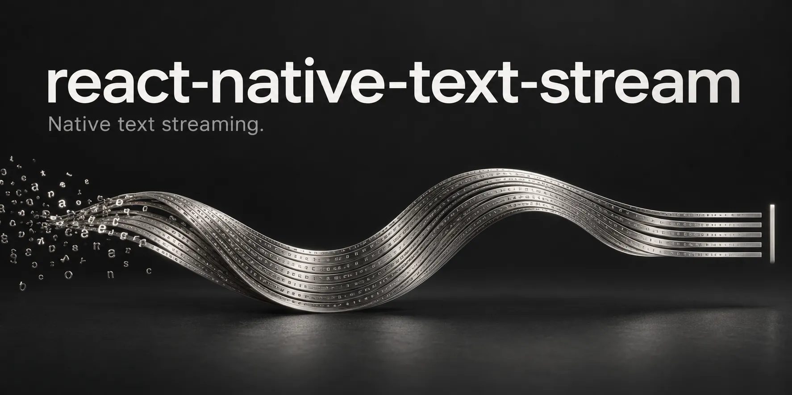
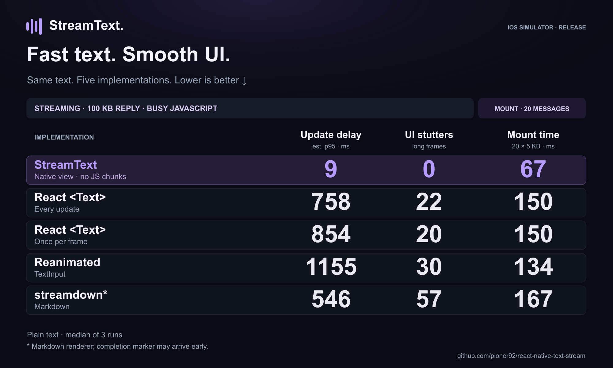
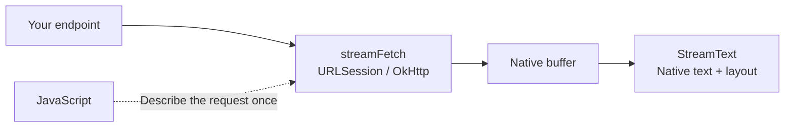

<p align="center">
  
</p>

<h1 align="center">StreamText</h1>

<p align="center">
  <strong>Native text streaming for React Native.</strong><br />
  Keep AI answers, logs, and transcripts flowing while JavaScript is busy.
</p>

<p align="center">
  <a href="#compatibility"></a>
  <a href="#compatibility"></a>
  <a href="#quick-start"></a>
  <a href="LICENSE"></a>
</p>

<p align="center">
  <a href="#quick-start"><strong>Quick start</strong></a> ·
  <a href="#performance">Performance</a> ·
  <a href="docs/usage.md">Guides</a> ·
  <a href="docs/api.md">API reference</a> ·
  <a href="example/README.md">Example app</a>
</p>

StreamText renders a streaming HTTP response in a native text view. Its own `streamFetch` writes the
response into native memory; the view reads and lays out the new text without sending each chunk
through JavaScript.

```tsx
import { StreamText } from 'react-native-text-stream';

export function Answer({ url }: { url: string }) {
  return <StreamText request={{ url }} fontSize={16} lineHeight={24} />;
}
```

By default your endpoint returns **plain UTF-8 text**. StreamText handles the native request
and rendering. Select a native SSE/NDJSON parser with `parser: { provider: 'openai-chat' }`;
see the [protocol guide](docs/protocols.md) for providers and custom fields. Opt into native Markdown with
`format="markdown" markdownFlavor="gfm"` for styled text, table grids, async images and fenced-code highlighting; see the [Markdown guide](docs/markdown.md)
for supported elements and performance limits.

## Why StreamText?

- **No JavaScript callbacks per chunk.** No per-chunk `setState`, React render, or JS text decoding.
- **Streaming continues when JS is busy.** Network delivery, text updates, and growing the view happen natively.
- **Built for chat layouts.** Set the width; the component grows with its content and supports native text selection.
- **A built-in fetcher.** URLSession on iOS and React Native’s OkHttp client on Android. No extra streaming library.
- **Control the lifetime.** Use a request prop for a single view, a `streamId` for remounting list items, or an imperative ref.

[Watch the rich Markdown demo](media/markdown-announcement/streamtext-rich-markdown-twitter-v4.mp4) ·
[Watch the JS-blocking demo](media/native-text-streaming-demo.mp4) ·
[Explore the architecture](docs/architecture.md)

## Quick start

> **Experimental preview.** The API may change before a stable release.

```sh
npm install react-native-text-stream
```

Then install iOS pods and rebuild the native app. Follow the
[installation guide](docs/getting-started.md#install-from-npm) for platform steps, or the
[example setup](example/README.md) to run the repository demo.
The library itself has no runtime dependencies beyond React and React Native.

### Stream a response

Pass a URL that returns a plain-text stream. For a POST request, supply a body and headers:

```tsx
import { StreamText } from 'react-native-text-stream';

type AnswerProps = {
  endpoint: string;
  prompt: string;
};

export function StreamingAnswer({ endpoint, prompt }: AnswerProps) {
  return (
    <StreamText
      request={{
        url: endpoint,
        method: 'POST',
        headers: { 'Content-Type': 'application/json' },
        body: JSON.stringify({ prompt }),
      }}
      fontSize={16}
      lineHeight={24}
      color="#EDE9FE"
      style={{ padding: 16, borderRadius: 16, backgroundColor: '#181426' }}
    />
  );
}
```

Without a `streamId`, the request belongs to the mounted view and is aborted on unmount.
Equivalent request values do not restart it, so an inline request object is supported.

### Start a stream, render it anywhere

Use `streamFetch` to start the request separately and connect a view with the same `streamId`:

```tsx
import { StreamText, streamFetch } from 'react-native-text-stream';

// Start in your send-message handler.
streamFetch(url, { streamId: message.id });

// Render anywhere using the same ID.
<StreamText streamId={message.id} />
```

The stream keeps running when the view unmounts. Remount with the same ID to reconnect.

[Cancellation and completion](docs/usage.md) · [Lists and persistent streams](docs/usage.md) · [All props](docs/api.md)

## Performance

**100 KB of streaming text, with JavaScript busy:** StreamText recorded an estimated **9 ms p95
update delay** and **0 UI stutters** in the measured scenario.

<p align="center">
  <a href="docs/benchmarks.md">
    
  </a>
</p>

**iOS Simulator · Release · median of 3 runs.** Streaming uses a 100 KB answer plus a 40 ms JS task
every 100 ms. Mount is a separate test with 20 finished messages of approximately 5 KB each.

Timings estimate UI progress. `streamdown` also parses Markdown and may finish after its timing marker.
See [how we measure delay and UI stutters](docs/benchmarks.md#what-is-measured) for definitions and limitations.

[Full results and methodology](docs/benchmarks.md) ·
[Raw streaming data](media/benchmark-card-v2/raw-streaming.json) ·
[Raw mount data](media/benchmark-card-v2/raw-mount.json)

## Choose an integration

| Your use case | Start here |
| --- | --- |
| One view owns one request | `<StreamText request={{ url }} />` |
| A message may scroll offscreen and remount | `streamFetch(url, { streamId })` + `<StreamText streamId={streamId} />` |
| Start or replace a stream from an event handler | `streamFetch()` + `useStreamTextRef().attach()` |
| Another native module produces the bytes | Pass a native-owned TSB1 buffer through `source` |

[Integration guides](docs/usage.md) cover each approach, including cleanup, cancellation, and retained-stream behavior.

## How it works



The native renderer consumes newly committed bytes and updates its text and Fabric layout state.
Streaming work is spread across frames; JS receives lifecycle events rather than every text chunk.

[Architecture](docs/architecture.md) · [Native buffer contract](docs/stream-buffer-format.md)

## Compatibility

| Requirement | Current scope |
| --- | --- |
| React Native | Developed and tested with **0.86.0**, New Architecture required |
| iOS | Example targets **15.1+**; the podspec follows React Native's minimum deployment target |
| Android | API 24+; viewport drawing optimizations use API 29+ |
| Expo | Requires a custom native build; unavailable in Expo Go. Expo integration is not yet validated. |
| Web / old architecture | Not supported |

The example and benchmark tools use Nitro Modules and Reanimated. **The StreamText package does not require them.**
See [setup and compatibility details](docs/getting-started.md).

## Documentation

| Guide | What you will find |
| --- | --- |
| [Getting started](docs/getting-started.md) | Requirements, npm installation, and backend response format |
| [Usage and recipes](docs/usage.md) | POST requests, completion, cancellation, refs, and list lifecycles |
| [API reference](docs/api.md) | Component props, `streamFetch`, stream handles, and status semantics |
| [Protocol parsing](docs/protocols.md) | Native SSE/NDJSON, provider presets and custom JSON fields |
| [Markdown](docs/markdown.md) | CommonMark/GFM support and rendering limits |
| [Architecture](docs/architecture.md) | Native transport, rendering, layout, and custom producers |
| [Benchmarks](docs/benchmarks.md) | Workloads, all results, limitations, and reproducibility |
| [Example app](example/README.md) | Run the demo, freeze JS, and explore the benchmark screens |
| [Changelog](CHANGELOG.md) | Release notes and current scope |

## Roadmap

- A JavaScript chunk-input API for existing SDKs and other transports.
- A broader validated compatibility matrix.

These are planned directions, not currently supported features or release commitments.

## Contributing

Bug reports, reproductions, and pull requests are welcome. Read the [contribution guide](CONTRIBUTING.md)
for local checks and native test workflows.

[Report a bug](https://github.com/pioner92/react-native-text-stream/issues) ·
[Discuss a feature](https://github.com/pioner92/react-native-text-stream/issues)

## License

[MIT](LICENSE) © Alex Shumihin
