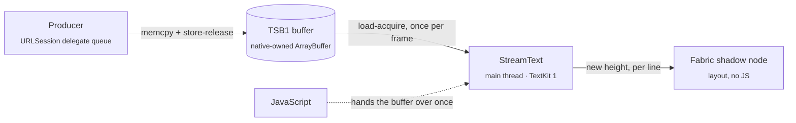

<p align="center">
  
</p>

<h3 align="center">Stream text from native code straight into a native view. No JS per chunk.</h3>

<p align="center">
  
  
  
  
  
</p>

<p align="center">
  <a href="#quick-start">Quick start</a> ·
  <a href="#api">API</a> ·
  <a href="#how-it-works">How it works</a> ·
  <a href="#benchmarks">Benchmarks</a> ·
  <a href="#run-the-example">Example</a> ·
  <a href="#roadmap">Roadmap</a>
</p>

---

LLM answers, logs, and transcripts arrive as a stream of bytes. In a typical React Native app each chunk
travels through JavaScript: a callback, a UTF-8 decode, a `setState`, a re-render of an ever-growing
`<Text>`. That is fine at a few tokens per second. It falls apart for long answers, fast streams, or a
busy JS thread.

**react-native-text-stream** takes JavaScript off that path. The network layer writes the response body
into a shared native buffer, and the `StreamText` view picks up new bytes on every frame, on the UI thread.
JavaScript hands the buffer over **once** and steps aside.

```tsx
const res = await fetch(url, { stream: true, nativeBuffer: true });

<StreamText source={res.nativeBuffer} />
```

🎬 **Demo:** [`media/native-text-streaming-demo.mp4`](media/native-text-streaming-demo.mp4). The JS
thread is frozen for 5 s, and the native card keeps streaming while the JS card stops dead.

## Highlights

- 💬 **Sizes itself to its text, like `<Text>`.** Drop it into a chat bubble, a list cell or a
  `ScrollView`; it grows natively as the text arrives.
- ⚡️ **Zero JS per chunk.** No bridge traffic, no `setState`, no re-renders while text streams in.
- 🧊 **Unaffected by a busy JS thread.** Text keeps flowing, and the bubble keeps growing, during heavy
  renders, navigation or a frozen JS thread.
- 📈 **O(new bytes) per frame.** Each frame decodes only the new UTF-8 slice. A 1 MB answer streams as
  smoothly as a 1 KB one.
- 🎯 **Smooth under bursts.** An adaptive per-frame budget spreads a burst over frames instead of dropping
  them.
- 🔋 **Idle-aware.** The frame loop pauses when the stream goes quiet and backs off to a cheap timer.
- 🧩 **Producer-agnostic.** Any native module that writes the small [TSB1](#the-tsb1-buffer) layout can
  feed the view. A patched [nitro-fetch](https://github.com/margelo/react-native-nitro-fetch) is the first
  producer.
- ♿️ **Accessible.** The view exposes the latest text to VoiceOver without snapshotting megabytes of it.

## Quick start

> [!NOTE]
> This is an **experimental prototype**: iOS only, not yet published to npm. The `nativeBuffer` option
> comes from a patched `react-native-nitro-fetch` vendored in this repo. See the [roadmap](#roadmap).

**Requirements:** React Native **0.86+** with the New Architecture, iOS 15.1+, and
`react-native-nitro-modules` (used by the patched nitro-fetch and by the package's benchmark
`FrameMonitor`). `StreamText` itself is a plain Fabric component and doesn't go through Nitro.

Clone the repo and use the workspace packages:

```sh
git clone https://github.com/alexshumihin/react-native-text-stream.git
cd react-native-text-stream
npm install                  # also applies the patches in patches/
```

### With state

```tsx
import { useState } from 'react';
import { Button, ScrollView } from 'react-native';
import { fetch } from 'react-native-nitro-fetch';
import { StreamText } from 'react-native-text-stream';

export function Chat() {
  const [buffer, setBuffer] = useState<ArrayBuffer>();

  const ask = async () => {
    // The body is written natively into `nativeBuffer` as it arrives.
    const res = await fetch('https://example.com/stream', { stream: true, nativeBuffer: true });
    setBuffer(res.nativeBuffer); // the only time JS touches the stream
  };

  return (
    <ScrollView>
      <Button title="Ask" onPress={ask} />
      <StreamText source={buffer} fontSize={16} lineHeight={22} style={{ padding: 12, borderRadius: 16, backgroundColor: '#eee' }} />
    </ScrollView>
  );
}
```

### With a ref (no re-render at all)

```tsx
import { fetch } from 'react-native-nitro-fetch';
import { StreamText, useStreamTextRef } from 'react-native-text-stream';

export function Chat() {
  const streamRef = useStreamTextRef();

  const ask = async () => {
    const res = await fetch('https://example.com/stream', { stream: true, nativeBuffer: true });
    streamRef.attach(res.nativeBuffer); // no setState, no re-render
  };

  return <StreamText ref={streamRef} fontSize={16} style={{ padding: 12 }} />;
}
```

Both styles work together. Whichever was set last, the `source` prop or `attach()`, wins.

## API

### `<StreamText />`

`StreamText` lays out like `<Text>`: it takes the width it is given and grows to the height of its text.
`padding`, `margin`, `backgroundColor`, `borderRadius` and the rest of the view style work as usual.

| Prop | Type | Default | Description |
|---|---|---|---|
| `source` | `ArrayBuffer \| null` | — | A TSB1 buffer, e.g. `res.nativeBuffer`. `null`/`undefined` detaches and clears the view. |
| `fontSize` | `number` | `15` | Font size in points. |
| `fontFamily` | `string` | system font | A family or PostScript name, e.g. `"Menlo"`. |
| `fontWeight` | `'normal' \| 'bold' \| '100'…'900'` | `'normal'` | |
| `color` | `ColorValue` | system label color | Any React Native color. |
| `lineHeight` | `number` | the font's own | Line height in points. |
| `letterSpacing` | `number` | `0` | |
| `textAlign` | `'auto' \| 'left' \| 'right' \| 'center' \| 'justify'` | `'auto'` | |
| `selectable` | `boolean` | `true` | |
| `selectionColor` | `ColorValue` | tint color | |
| `onStatusChange` | `(status, bytes) => void` | — | `'streaming'` when a stream starts; `'done'`, `'error'`, `'cancelled'` or `'truncated'` once all of its text is on screen. A buffer that is already finished when attached (e.g. a message remounted by a list) reports only its final status. |
| `ref` | `StreamTextRef` | — | From [`useStreamTextRef()`](#usestreamtextref), or any `useRef<StreamTextHandle>(null)`. |

### `useStreamTextRef()`

Returns a ref for `<StreamText ref={streamRef} />` that you can call directly. It is stable across renders.

| Method | Description |
|---|---|
| `attach(buffer)` | Starts rendering `buffer` without a React render. Called before the view mounts, it applies on mount. |
| `clear()` | Detaches and clears the view. |
| `getStatus()` | `{ status, bytes }`, read synchronously from the buffer's header and the last status event. |
| `getText()` | The text received so far, decoded from the buffer. |

A plain `useRef<StreamTextHandle>(null)` works too; call `ref.current?.attach(buffer)`.

For a fixed-height panel that follows the newest text (a log, a "thinking" box), wrap `StreamText` in an
inverted `ScrollView` (`transform: [{ scaleY: -1 }]` on the scroll view and on its child): offset 0 is then
the bottom, so the panel stays pinned to the tail without JS. The demo's native card does this.

### `fetch(url, { stream: true, nativeBuffer })`, from the patched nitro-fetch

| Option | Type | Description |
|---|---|---|
| `nativeBuffer` | `true \| { capacity?: number }` | Writes the body into a TSB1 buffer exposed as `res.nativeBuffer` instead of `res.body`. `true` reserves 16 MB of address space; pages are committed only as they're written. |

The body never crosses into JS. When the stream ends, fails or is cancelled, the buffer's status changes and
the view shows the final state.

## How it works



1. **Producer.** nitro-fetch appends every received chunk to the buffer on URLSession's queue and publishes
   it with a release store of `committed`. When the request finishes it sets `status`.
2. **Handoff.** JavaScript passes `res.nativeBuffer` to the view once: as the `source` prop, read straight
   from the JS value by the component's props parser, or through `ref.attach()`. Fabric view commands
   can't carry an `ArrayBuffer`, so `attach()` first puts it in a small C++ TurboModule
   (`StreamTextBuffers`) and sends the view the buffer's id.
3. **Renderer.** A `CADisplayLink` on the main thread reads `status`, then `committed`, with acquire loads.
   If there are new bytes, it decodes only that slice (a UTF-8 sequence split across chunks is carried
   over) and appends it to a TextKit 1 text view.
4. **Layout.** When the text gains a line, the view reports its new height through the Fabric shadow node's
   state. The update is applied on the main thread, so the bubble grows and the list re-lays out while the
   JS thread is busy.

**Frame loop details:**

- **Adaptive budget.** At most `bytesPerTick` per frame, re-estimated from the measured append and layout
  cost so the work stays around 6 ms per frame.
- **Incremental layout.** Contiguous TextKit 1 layout: appending lays out only the new tail, and the height
  comes from the used rect. The text view keeps a fixed, very tall frame and is clipped to the component,
  because a text view whose frame grows re-lays out all of its text.
- **Idle.** After 250 ms without data the display link pauses. A timer then checks the header every 33 ms
  and backs off to 100 ms after 2 s, while a model is "thinking". The display link is capped at 60 Hz.
- **Accessibility.** Only the last 2000 characters are exposed, in the component's visible frame, so an
  accessibility snapshot of a long stream stays cheap.

### The TSB1 buffer

A single-writer, multi-reader, append-only byte log in one block of memory. Any native producer can write it.
The full contract is in [`TextStreamBuffer.h`](packages/react-native-text-stream/ios/TextStreamBuffer.h).

| Offset | Field | Type | Notes |
|---|---|---|---|
| 0 | `magic` | `u32` | `0x31425354` (`"TSB1"`) |
| 4 | `version` | `u16` | `1` |
| 6 | `headerSize` | `u16` | `64` |
| 8 | `committed` | `u64` | bytes published; written with release, read with acquire |
| 16 | `capacity` | `u64` | size of the data region |
| 24 | `status` | `u32` | `OPEN 0` · `DONE 1` · `ERROR 2` · `CANCELLED 3` · `OVERFLOW 4`; the first terminal status wins |
| 64 | data | `u8[capacity]` | `[0, committed)` is immutable once published |

<details>
<summary><b>Writing your own producer (Swift)</b></summary>

```swift
// Allocate: anonymous mmap pages are only committed once written.
let size = Int(TSB_HEADER_SIZE) + capacity
let base = mmap(nil, size, PROT_READ | PROT_WRITE, MAP_PRIVATE | MAP_ANON, -1, 0)!
tsb_init(base, UInt64(capacity))
let buffer = ArrayBuffer.wrap(dataWithoutCopy: base, size: size, onDelete: { munmap(base, size) })
// Return `buffer` to JS and pass it to <StreamText source={…} />.

// From one writer thread, as data arrives:
bytes.withUnsafeBytes { _ = tsb_append(base, $0.baseAddress!, UInt64($0.count)) }

// When finished:
tsb_set_status(base, UInt32(TSB_STATUS_DONE))
```

The buffer must be **native-owned**. The view ignores `ArrayBuffer`s created in JavaScript, because those
may only be touched on the JS thread.

</details>

## Benchmarks

Five ways to stream the same answer into the **last bubble of a chat list**: the bubble grows with the
text, the list scrolls. Plain text, 14 / 21 pt. Release build, iPhone 17 Pro Max **simulator**, medians of
2 runs:

| | Variant | How text reaches the screen |
|---|---|---|
| A1 | JS, naive | `ReadableStream` → `TextDecoder` → `setState` per chunk → `<Text>` |
| A2 | JS, best practice | same, one `setState` per frame |
| B1 | Reanimated "ReText" | JS writes a shared value → `TextInput.text` on the UI thread |
| B2 | react-native-streamdown | `setState` per frame → remend on a worklet → enriched-markdown view |
| **C** | **react-native-text-stream** | `nativeBuffer` → `StreamText`, no JS per chunk |

| Scenario | A1 | A2 | B1 | B2 | **C** |
|---|---|---|---|---|---|
| **S1** LLM pace, 5 KB @ 0.8 KB/s · latency p50 / p95 | 14 / 46 ms | 29 / 62 ms | 34 / 71 ms¹ | 43 / 50 ms | **26 / 34 ms** |
| S1 · hitches · worst UI frame | 71 · 56 ms | 69 · 70 ms | 56 · 51 ms | 0 · 17 ms | **0 · 17 ms** |
| **S2** long answer, 100 KB @ 20 KB/s · latency p50 / p95 | 176 / 701 ms | 210 / 834 ms | 524 / 1023 ms¹ | 139 / 308 ms | **26 / 33 ms** |
| S2 · hitches · worst UI frame | 24 · 868 ms | 23 · 923 ms | 31 · 550 ms | 62 · 190 ms | **0 · 17 ms** |
| **S4** S2 + 40 ms JS task every 100 ms · latency p50 / p95 | 171 / 662 ms | 197 / 790 ms | 531 / 1101 ms¹ | 164 / 342 ms | **26 / 33 ms** |
| S4 · hitches · worst UI frame | 23 · 932 ms | 22 · 909 ms | 29 · 591 ms | 62 · 176 ms | **0 · 17 ms** |
| **S5** 64 B every 400 ms · latency p50 / p95 | 13 / 38 ms | 30 / 55 ms | 32 / 49 ms¹ | 44 / 50 ms | 35 / 47 ms² |
| S5 · hitches · worst UI frame | 14 · 38 ms | 15 · 41 ms | 16 · 55 ms | 0 · 17 ms | **0 · 17 ms** |
| **S3** 1 MB burst · worst UI frame | 263 ms | 17 ms³ | 4966 ms | 1896 ms | 461 ms |

**Takeaways**

- **StreamText is the only variant with no hitches and the same latency in every paced scenario**: 26 /
  33 ms whether the answer is 5 KB or 100 KB, and whether the JS thread is idle or busy (S4).
- Every `setState` path janks as soon as the bubble grows (50–70 hitches at LLM pace) and reaches 0.7–0.8 s
  p95 with ~900 ms frames on a long answer.
- Reanimated doesn't help here: the bubble has to re-measure a growing `TextInput`, so it lands at ~1 s p95.
- B2 is the best of the JS-driven paths (it measures off the main thread) but still drops 60+ frames on a
  long answer. It also parses Markdown, which the others don't.
- **Known limit:** a 1 MB burst into one bubble (S3). StreamText shows all of it in 2.3 s, but TextKit lays
  out the whole megabyte, with one 461 ms frame. Paced streams, even long ones, don't hit this.

<details>
<summary><b>Methodology and footnotes</b></summary>

- **Latency** is the time from the server writing a byte to the first frame after the main thread has
  drawn it. The server send log is the clock, since the simulator and the host share `Date.now()`.
- **Hitches** are UI frames over 1.5× the frame budget. They are monitored until the UI is smooth again
  (10 on-time frames).
- **Worst UI frame** is the longest UI frame in the run.

¹ B1 applies text in a Reanimated frame callback, so "shown" is taken one frame later than the update's
first frame.
² Every chunk arrives after StreamText has gone idle, so it pays the idle poll (≤ 33 ms) on top.
³ S3 latency is left out: for the JS variants "shown" marks the React commit, not text on screen, and a
1 MB `<Text>` isn't actually drawn by then. StreamText's own log shows the last byte on screen 2.3 s after
the first.

**Caveats:** simulator timing (frame pacing, no thermal limits). B2's own async work may land after its
mark, so its latency is a lower bound. Device numbers are pending.

Raw results: [`bench-results/bench-bubble-2026-10-11T00-00-54-966Z.json`](bench-results/bench-bubble-2026-10-11T00-00-54-966Z.json).
Earlier `bench-results/bench-*.json` files measured the previous, self-scrolling StreamText in a fixed box.

</details>

## Run the example

```sh
npm install
cd example && npm run pod
node ../server/stream-server.mjs   # local streaming server on :9877
npm start                          # Metro on :8081
npm run ios
```

The demo screen streams the same response into two cards at once:

- **StreamText**, the native path.
- A **JS baseline**: stock nitro-fetch `ReadableStream` → UTF-8 decode → `setState` → `<Text>`, with one JS
  callback per chunk.

**Freeze JS · 5s** busy-waits the JS thread. The JS card and the JS-thread pulse stop, while the native
card and the UI-thread pulse keep going.

**Chat ›** streams an answer into the last bubble of a chat list: the bubble is a `StreamText` with padding
and a background, handed its buffer through the ref. Press **Freeze 5s** while it streams: the bubble keeps
growing and pushes the list down, while the JS tick counter stops.

**Benchmarks ›** opens the benchmark screen. Build **Release** (`-configuration Release`, no Metro needed),
start the stream server and tap **Run all**. Results land in `bench-results/`. `FOCUS` in
`example/src/bench/config.ts` narrows a run.

> [!WARNING]
> Don't drive the UI with accessibility tools (e.g. automation that snapshots the view tree) during a
> benchmark run. Snapshotting a view that holds megabytes of text can stall the main thread for seconds.

<details>
<summary><b>Streaming server options</b></summary>

`server/stream-server.mjs` serves a demo text in chunks:

| Query | Meaning |
|---|---|
| `fmt=raw\|sse\|ndjson` | response format |
| `chunk=<n>` | chunk size: bytes for `raw`, characters otherwise |
| `tps=<n>` | chunks per second; `0` writes as fast as the socket drains |
| `repeat=<n>` / `bytes=<n>` | body length: paragraphs, or an approximate size |
| `id=<run>` | records a per-run send log, read with `GET /log?id=<run>` |

`POST /results?name=<file>` saves benchmark results to `bench-results/`.

</details>

## Repository layout

| Path | What's inside |
|---|---|
| [`packages/react-native-text-stream`](packages/react-native-text-stream) | `StreamText`: a hand-written Fabric component (C++ shadow node and props in `cpp/`, iOS view and renderer in `ios/fabric/`), the `StreamTextBuffers` TurboModule, the TSB1 header, and a Nitro `FrameMonitor` for benchmarks |
| [`packages/react-native-nitro-fetch`](packages/react-native-nitro-fetch) | nitro-fetch 1.8.0 (`aad957e`) plus the `nativeBuffer` patch, also kept as [`patches/react-native-nitro-fetch+native-buffer.patch`](patches/react-native-nitro-fetch+native-buffer.patch) |
| [`patches/`](patches) | applied on `postinstall`: upstream nitro-fetch's nitrogen fix and the Metro patch for worklets Bundle Mode |
| [`example/`](example) | demo and benchmark app |
| [`server/`](server) | local streaming server |

## Roadmap

- [ ] Android: a `StreamText` renderer and the `nativeBuffer` writer for Cronet
- [ ] Upstream the `nativeBuffer` option to react-native-nitro-fetch
- [ ] Publish to npm
- [ ] Benchmarks on physical devices
- [ ] Shrink-to-fit width for short messages (today the view fills the width it is given)
- [ ] Markdown rendering on the native side

## Contributing

Issues and pull requests are welcome. For larger changes, please open an issue first to discuss the design.

## License

[MIT](packages/react-native-text-stream/LICENSE) © Alex Shumihin

<p align="center"><sub>Built with <a href="https://nitro.margelo.com">Nitro Modules</a>.</sub></p>
