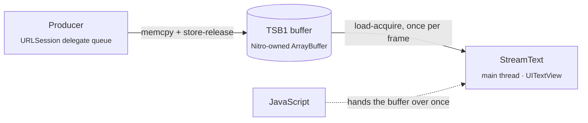

<p align="center">
  
</p>

<h3 align="center">Stream text from native code straight into a native view. No JS per chunk.</h3>

<p align="center">
  
  
  
  
  
</p>

<p align="center">
  <a href="#quick-start">Quick start</a> ·
  <a href="#api">API</a> ·
  <a href="#how-it-works">How it works</a> ·
  <a href="#benchmarks">Benchmarks</a> ·
  <a href="#run-the-example">Example</a> ·
  <a href="#roadmap">Roadmap</a>
</p>

---

LLM answers, logs, and transcripts arrive as a stream of bytes. In a typical React Native app each chunk
travels through JavaScript: a callback, a UTF-8 decode, a `setState`, a re-render of an ever-growing
`<Text>`. That is fine at a few tokens per second. It falls apart for long answers, fast streams, or a
busy JS thread.

**react-native-text-stream** takes JavaScript off that path. The network layer writes the response body
into a shared native buffer, and the `StreamText` view picks up new bytes on every frame, on the UI thread.
JavaScript hands the buffer over **once** and steps aside.

```tsx
const res = await fetch(url, { stream: true, nativeBuffer: true });

<StreamText source={res.nativeBuffer} />
```

🎬 **Demo:** [`media/native-text-streaming-demo.mp4`](media/native-text-streaming-demo.mp4). The JS
thread is frozen for 5 s, and the native card keeps streaming while the JS card stops dead.

## Highlights

- ⚡️ **Zero JS per chunk.** No bridge traffic, no `setState`, no re-renders while text streams in.
- 🧊 **Unaffected by a busy JS thread.** Text keeps flowing during heavy renders, navigation or a frozen JS
  thread.
- 📈 **O(new bytes) per frame.** Each frame decodes only the new UTF-8 slice. A 1 MB answer streams as
  smoothly as a 1 KB one.
- 🎯 **Smooth under bursts.** An adaptive per-frame budget spreads a burst over frames instead of dropping
  them.
- 🔋 **Idle-aware.** The frame loop pauses when the stream goes quiet and backs off to a cheap timer.
- 🧩 **Producer-agnostic.** Any native module that writes the small [TSB1](#the-tsb1-buffer) layout can
  feed the view. A patched [nitro-fetch](https://github.com/margelo/react-native-nitro-fetch) is the first
  producer.
- ♿️ **Accessible.** The view exposes the latest text to VoiceOver without snapshotting megabytes of it.

## Quick start

> [!NOTE]
> This is an **experimental prototype**: iOS only, not yet published to npm. The `nativeBuffer` option
> comes from a patched `react-native-nitro-fetch` vendored in this repo. See the [roadmap](#roadmap).

**Requirements:** React Native **0.86+** with the New Architecture, `react-native-nitro-modules` 0.37,
iOS 15.1+ (TextKit 2 on iOS 16+).

Clone the repo and use the workspace packages:

```sh
git clone https://github.com/alexshumihin/react-native-text-stream.git
cd react-native-text-stream
npm install                  # also applies the patches in patches/
```

### With state

```tsx
import { useState } from 'react';
import { Button } from 'react-native';
import { fetch } from 'react-native-nitro-fetch';
import { StreamText } from 'react-native-text-stream';

export function Chat() {
  const [buffer, setBuffer] = useState<ArrayBuffer>();

  const ask = async () => {
    // The body is written natively into `nativeBuffer` as it arrives.
    const res = await fetch('https://example.com/stream', { stream: true, nativeBuffer: true });
    setBuffer(res.nativeBuffer); // the only time JS touches the stream
  };

  return (
    <>
      <Button title="Ask" onPress={ask} />
      <StreamText source={buffer} fontSize={16} style={{ flex: 1 }} />
    </>
  );
}
```

### With a ref (no re-render at all)

```tsx
import { fetch } from 'react-native-nitro-fetch';
import { StreamText, useStreamTextRef } from 'react-native-text-stream';

export function Chat() {
  const streamRef = useStreamTextRef();

  const ask = async () => {
    const res = await fetch('https://example.com/stream', { stream: true, nativeBuffer: true });
    streamRef.attach(res.nativeBuffer); // no setState, no re-render
  };

  return <StreamText ref={streamRef} style={{ flex: 1 }} />;
}
```

Both styles work together. Whichever was set last, the `source` prop or `attach()`, wins.

## API

### `<StreamText />`

| Prop | Type | Default | Description |
|---|---|---|---|
| `source` | `ArrayBuffer \| null` | — | A TSB1 buffer, e.g. `res.nativeBuffer`. `null`/`undefined` detaches and clears the view. |
| `fontSize` | `number` | `15` | Font size in points. |
| `color` | `string` | system label color | Text color, `#RRGGBB` or `#RRGGBBAA`. |
| `showStats` | `boolean` | `false` | Shows a native `status · bytes` pill, updated without JS. |
| `ref` | `StreamTextRef` | — | From [`useStreamTextRef()`](#usestreamtextref), or any `useRef<StreamTextHandle>(null)`. |
| `style` | `ViewStyle` | — | Any view style. |

### `useStreamTextRef()`

Returns a ref for `<StreamText ref={streamRef} />` that you can call directly. It is stable across renders.

| Method | Description |
|---|---|
| `attach(buffer)` | Starts rendering `buffer` without a React render. Called before the view mounts, it applies on mount. |
| `clear()` | Detaches and clears the view. |

A plain `useRef<StreamTextHandle>(null)` works too; call `ref.current?.attach(buffer)`.

The view starts reading as soon as a source is attached. It follows the tail while you're scrolled to the
bottom and stops following when you scroll up. Selection works.

### `fetch(url, { stream: true, nativeBuffer })`, from the patched nitro-fetch

| Option | Type | Description |
|---|---|---|
| `nativeBuffer` | `true \| { capacity?: number }` | Writes the body into a TSB1 buffer exposed as `res.nativeBuffer` instead of `res.body`. `true` reserves 16 MB of address space; pages are committed only as they're written. |

The body never crosses into JS. When the stream ends, fails or is cancelled, the buffer's status changes and
the view shows the final state.

## How it works



1. **Producer.** nitro-fetch appends every received chunk to the buffer on URLSession's queue and publishes
   it with a release store of `committed`. When the request finishes it sets `status`.
2. **Handoff.** JavaScript gets `res.nativeBuffer`, a Nitro-owned `ArrayBuffer`, and passes it to the view.
   That is its only job.
3. **Renderer.** A `CADisplayLink` on the main thread reads `status`, then `committed`, with acquire loads.
   If there are new bytes, it decodes only that slice. A UTF-8 sequence split across chunks is carried over
   to the next frame, and the text is appended to a TextKit 2 `UITextView`.

**Frame loop details:**

- **Adaptive budget.** At most `bytesPerTick` per frame, re-estimated from the measured append and layout
  cost so the work stays around 6 ms per frame.
- **Idle.** After 250 ms without data the display link pauses. A timer then checks the header every 33 ms
  and backs off to 100 ms after 2 s, while a model is "thinking". The display link is capped at 60 Hz.
- **Accessibility.** Only the last 2000 characters are exposed. An accessibility snapshot of a 1 MB stream
  takes ~0.3 s instead of ~10 s.

### The TSB1 buffer

A single-writer, multi-reader, append-only byte log in one block of memory. Any native producer can write it.
The full contract is in [`TextStreamBuffer.h`](packages/react-native-text-stream/ios/TextStreamBuffer.h).

| Offset | Field | Type | Notes |
|---|---|---|---|
| 0 | `magic` | `u32` | `0x31425354` (`"TSB1"`) |
| 4 | `version` | `u16` | `1` |
| 6 | `headerSize` | `u16` | `64` |
| 8 | `committed` | `u64` | bytes published; written with release, read with acquire |
| 16 | `capacity` | `u64` | size of the data region |
| 24 | `status` | `u32` | `OPEN 0` · `DONE 1` · `ERROR 2` · `CANCELLED 3` · `OVERFLOW 4`; the first terminal status wins |
| 64 | data | `u8[capacity]` | `[0, committed)` is immutable once published |

<details>
<summary><b>Writing your own producer (Swift)</b></summary>

```swift
// Allocate: anonymous mmap pages are only committed once written.
let size = Int(TSB_HEADER_SIZE) + capacity
let base = mmap(nil, size, PROT_READ | PROT_WRITE, MAP_PRIVATE | MAP_ANON, -1, 0)!
tsb_init(base, UInt64(capacity))
let buffer = ArrayBuffer.wrap(dataWithoutCopy: base, size: size, onDelete: { munmap(base, size) })
// Return `buffer` to JS and pass it to <StreamText source={…} />.

// From one writer thread, as data arrives:
bytes.withUnsafeBytes { _ = tsb_append(base, $0.baseAddress!, UInt64($0.count)) }

// When finished:
tsb_set_status(base, UInt32(TSB_STATUS_DONE))
```

The buffer must be **native-owned**. The view ignores `ArrayBuffer`s created in JavaScript, because those
may only be touched on the JS thread.

</details>

## Benchmarks

Five ways to render the same stream (plain text, 14 pt, same box). Release build, iPhone 17 Pro Max
**simulator**, medians of 3 runs:

| | Variant | How text reaches the screen |
|---|---|---|
| A1 | JS, naive | `ReadableStream` → `TextDecoder` → `setState` per chunk → `<Text>` |
| A2 | JS, best practice | same, one `setState` per frame |
| B1 | Reanimated "ReText" | JS writes a shared value → `TextInput.text` on the UI thread |
| B2 | react-native-streamdown | `setState` per frame → remend on a worklet → enriched-markdown view |
| **C** | **react-native-text-stream** | `nativeBuffer` → `StreamText`, no JS per chunk |

| Scenario | A1 | A2 | B1 | B2 | **C** |
|---|---|---|---|---|---|
| **S1** LLM pace, 5 KB @ 0.8 KB/s · latency p50 / p95 | 13 / 47 ms | 29 / 61 ms | 29 / 36 ms² | 43 / 50 ms | **26 / 33 ms** |
| S1 · hitches · worst UI frame | 67 · 56 ms | 65 · 70 ms | 0 · 17 ms | 0 · 17 ms | **0 · 17 ms** |
| **S2** long answer, 100 KB @ 20 KB/s · latency p50 / p95 | 187 / 702 ms | 180 / 691 ms | 30 / 38 ms² | 126 / 255 ms | **26 / 33 ms** |
| S2 · hitches · worst UI frame | 24 · 861 ms | 23 · 886 ms | 0 · 17 ms | 65 · 171 ms | **0 · 17 ms** |
| **S3** 1 MB burst · shown · UI smooth again | blank¹ | blank¹ | 79 · 112 ms³ | 38 · 3219 ms | **100 · 132 ms** |
| S3 · worst UI frame | — | — | 46 ms | 1695 ms | **34 ms** |
| **S4** S2 + 40 ms JS task every 100 ms · latency p50 / p95 | 182 / 722 ms | 183 / 722 ms | 49 / 81 ms² | 143 / 320 ms | **26 / 34 ms** |
| S4 · hitches · worst UI frame | 23 · 889 ms | 23 · 911 ms | 38 · 44 ms | 63 · 180 ms | **0 · 17 ms** |
| **S5** 64 B every 400 ms · latency p50 / p95 | 19 / 49 ms | 34 / 63 ms | 29 / 35 ms² | 45 / 50 ms | 36 / 44 ms⁴ |
| S5 · hitches · worst UI frame | 14 · 42 ms | 18 · 40 ms | 0 · 17 ms | 0 · 17 ms | **0 · 17 ms** |

**Takeaways**

- At LLM pace (S1) every variant keeps up on latency, but the variants that re-render `<Text>` jank (60+
  hitches).
- As the text grows (S2), `setState` paths reach 0.7 s p95 and ~900 ms frames. Reanimated and StreamText
  stay smooth and within a frame of each other.
- With a busy JS thread (S4), StreamText is unaffected (p95 34 ms, no hitches). Every JS-driven path
  degrades, Reanimated included.
- A 1 MB burst (S3) is spread over frames: the worst frame is 34 ms, and all of it is shown in 100 ms.
- B2 also parses Markdown, which the others don't. It is the richest renderer, not a like-for-like
  plain-text one.

<details>
<summary><b>Methodology and footnotes</b></summary>

- **Latency** is the time from the server writing a byte to the first frame after the main thread has
  drawn it. The server send log is the clock, since the simulator and the host share `Date.now()`.
- **Hitches** are UI frames over 1.5× the frame budget. They are monitored until the UI is smooth again
  (10 on-time frames).
- **Worst UI frame** is the longest UI frame in the run.

¹ In this setup, RN `<Text>` holding 1 MB inside a `ScrollView` rendered nothing on screen, so A1/A2 S3
times measure nothing.
² B1 applies text in a Reanimated frame callback, so "shown" is taken one frame later than the update's
first frame. Measured one frame earlier (a lower bound), B1 is 13 / 21 ms in S2 and 19 / 51 ms in S4
(`bench-results/bench-2026-10-10T21-01-00-064Z.json`). B1 and C are within a frame of each other on latency.
³ B1 doesn't scroll to follow the tail; C does.
⁴ Every chunk arrives after StreamText has gone idle, so it pays the idle poll (≤ 33 ms) on top.

**Caveats:** simulator timing (frame pacing, no thermal limits). B2's own async work may land after its
mark, so its latency is a lower bound. Device numbers are pending.

Raw results: [`bench-results/bench-2026-10-10T21-36-51-079Z.json`](bench-results/bench-2026-10-10T21-36-51-079Z.json).

</details>

## Run the example

```sh
npm install
cd example && npm run pod
node ../server/stream-server.mjs   # local streaming server on :9877
npm start                          # Metro on :8081
npm run ios
```

The demo screen streams the same response into two cards at once:

- **StreamText**, the native path.
- A **JS baseline**: stock nitro-fetch `ReadableStream` → UTF-8 decode → `setState` → `<Text>`, with one JS
  callback per chunk.

**Freeze JS · 5s** busy-waits the JS thread. The JS card and the JS-thread pulse stop, while the native
card and the UI-thread pulse keep going.

**Benchmarks ›** opens the benchmark screen. Build **Release** (`-configuration Release`, no Metro needed),
start the stream server and tap **Run all**. Results land in `bench-results/`. `FOCUS` in
`example/src/bench/config.ts` narrows a run.

> [!WARNING]
> Don't drive the UI with accessibility tools (e.g. automation that snapshots the view tree) during a
> benchmark run. Snapshotting a view that holds megabytes of text can stall the main thread for seconds.

<details>
<summary><b>Streaming server options</b></summary>

`server/stream-server.mjs` serves a demo text in chunks:

| Query | Meaning |
|---|---|
| `fmt=raw\|sse\|ndjson` | response format |
| `chunk=<n>` | chunk size: bytes for `raw`, characters otherwise |
| `tps=<n>` | chunks per second; `0` writes as fast as the socket drains |
| `repeat=<n>` / `bytes=<n>` | body length: paragraphs, or an approximate size |
| `id=<run>` | records a per-run send log, read with `GET /log?id=<run>` |

`POST /results?name=<file>` saves benchmark results to `bench-results/`.

</details>

## Repository layout

| Path | What's inside |
|---|---|
| [`packages/react-native-text-stream`](packages/react-native-text-stream) | `StreamText` Nitro view, the TSB1 header, and `FrameMonitor` for benchmarks |
| [`packages/react-native-nitro-fetch`](packages/react-native-nitro-fetch) | nitro-fetch 1.8.0 (`aad957e`) plus the `nativeBuffer` patch, also kept as [`patches/react-native-nitro-fetch+native-buffer.patch`](patches/react-native-nitro-fetch+native-buffer.patch) |
| [`patches/`](patches) | applied on `postinstall`: upstream nitro-fetch's nitrogen fix and the Metro patch for worklets Bundle Mode |
| [`example/`](example) | demo and benchmark app |
| [`server/`](server) | local streaming server |

## Roadmap

- [ ] Android: a `StreamText` renderer and the `nativeBuffer` writer for Cronet
- [ ] Upstream the `nativeBuffer` option to react-native-nitro-fetch
- [ ] Publish to npm
- [ ] Benchmarks on physical devices
- [ ] Styling: line height, font family, text alignment
- [ ] Markdown rendering on the native side

## Contributing

Issues and pull requests are welcome. For larger changes, please open an issue first to discuss the design.

## License

[MIT](packages/react-native-text-stream/LICENSE) © Alex Shumihin

<p align="center"><sub>Built with <a href="https://nitro.margelo.com">Nitro Modules</a>.</sub></p>
