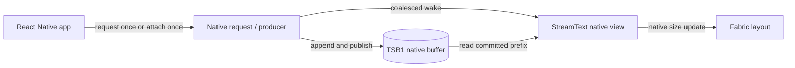

# Architecture

[← README](../README.md) · [Usage](usage.md) · [API reference](api.md)

`react-native-text-stream` is designed for the path between an incoming response
and a native text view. JavaScript configures the request or attaches a source;
the response body does not need a JavaScript callback for each chunk.

## Request lifecycle

`streamFetch()` and the `request` prop use platform-native networking. The native
side allocates an append-only body buffer, writes bytes as they arrive, publishes
the committed length, and marks a terminal status when the request ends.

The renderer consumes the committed prefix on the native UI path and updates its
layout as text gains height. Work is coalesced; a backlog may span multiple UI
ticks. There is no promise that every network write becomes a distinct rendered
frame, or that a particular latency is universal—font shaping, layout, payload,
device, and host load all matter.

`TextStream.response` is a transport milestone: HTTP headers arrived.
`TextStream.done` is transport completion. `onStatusChange` is a display
milestone: the view has processed the terminal buffer state. They should not be
used interchangeably.

## Ownership models

| Model | Owner | Lifetime |
| --- | --- | --- |
| `<StreamText request={…} />` | The view | Aborts when the view unmounts. |
| `<StreamText streamId={id} request={…} />` | Native named-stream registry | Outlives a particular view instance. |
| `streamFetch()` plus `source` or `ref.attach()` | The caller | The caller decides when to abort/detach. |

An explicit `source` overrides a same-view `streamId` until that source is
removed. A later named request under an existing id replaces and cancels the
previous request. Refer to [usage](usage.md#retention-and-replay) for the
deliberate no-silent-replay behavior of unsafe methods.

## Native producers and TSB1

The view can consume a native-owned `ArrayBuffer` that follows the TSB1
(Text Stream Buffer v1) contract. This enables another native module to produce
plain text without routing every chunk through JavaScript.

TSB1 is a single-writer, multi-reader, append-only byte log. The producer writes
bytes, publishes `committed` with release semantics, and writes one terminal
status. Consumers read `committed` with acquire semantics and never modify the
body. The full binary layout and ownership requirements are in
[stream-buffer-format.md](stream-buffer-format.md).

JavaScript-created `ArrayBuffer`s are intentionally not accepted as producers;
their ownership and thread-safety do not meet the native producer contract.

## Text and protocol boundary

The renderer receives UTF-8 body bytes and displays plain text. It does not
interpret Markdown, JSON, SSE, NDJSON, tool calls, or an LLM provider protocol.
Feed it a plain-text endpoint, transform structured events upstream, or implement
a native producer that emits the desired text.

Network completion means the platform ended the body; it does not independently
verify application-level integrity. Validate structured payloads or checksums in
the layer that owns that protocol.

## What to measure

Measure the exact screen and payload you ship. Useful separate signals are:

- response-to-display delay while a long answer streams;
- UI stutters or long UI frames under competing JavaScript work;
- mount time for already-finished messages; and
- memory/scrolling behavior for realistic conversation history.

The repository's [benchmark guide](benchmarks.md) documents the published test
setup and its limits. Benchmarks demonstrate a workload; they do not guarantee a
specific result on every application or device.
